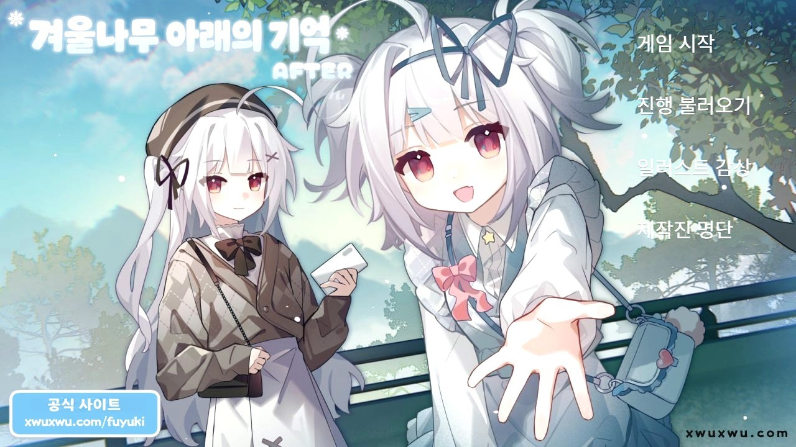

# 冬日树下的回忆AFTER (겨울나무 아래의 기억 AFTER) 한국어 패치

Steam 비주얼 노벨 **冬日树下的回忆AFTER** (겨울나무 아래의 기억 AFTER)의 비공식 한국어 패치입니다.
- 본편 **冬日树下的回忆**의 한국어 패치는 [별도 저장소](https://github.com/fluffy803/WinterTree-KoreanPatch)에 있습니다.

## 설치

1. [Releases](../../releases)에서 `WinterTreeAfter_KoreanPatch_v*.zip`을 받습니다.
2. 압축 안의 `resources` 폴더를 게임 폴더(`Winter Tree AFTER.exe`가 있는 폴더)에 붙여넣습니다.

## 번역 범위

| 항목 | 내용 |
|---|---|
| 대사·UI | 시나리오 3,491줄, 메뉴 버튼, 설정 화면 미리보기 문구 |
| 이미지 | 타이틀 로고·배경, 설정 화면, 편지 CG, 로고 컷 |
| 동영상 | 시작 안내문, 주제가 MV 가사 |

## 면책

팬 번역이며 개발사·배급사와 관계가 없습니다. 게임의 권리는 각 권리자에게 있습니다.
